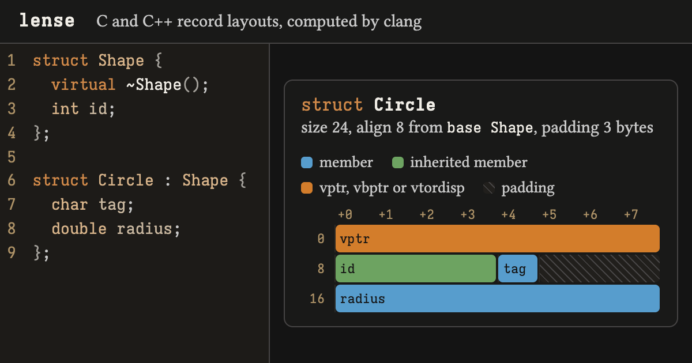

# lense



`lense` prints the memory layout of every C and C++ struct, class and union in a source file: member offsets, padding, base subobjects, and vtable pointers. It reads the layouts from clang 23 through *LibTooling*, and also runs in a browser as WebAssembly.

```
$ printf 'struct Msg { char tag; long len; char flags; };\n' | lense --target=x86_64-linux-gnu -
struct Msg  size 24, align 8 from len, padding 14 bytes
  is_standard_layout yes, is_trivially_copyable yes, has_unique_object_representations no
  offset  size  align
       0     1      1  char tag
       1     7         padding
       8     8      8  long len
      16     1      1  char flags
      17     7         padding
  reordering the fields saves 8 bytes (size 16): tag, flags, len
```

## Building

```sh
nix build          # command-line tool, with tests
nix build .#web    # browser front end, as a static site in result/
```

Without Nix, pass any LLVM 23 install to CMake with `-DLLVM_DIR=<prefix>/lib/cmake/llvm`.

## Usage

```
lense [options] <file | -> [-- <clang arguments>]
```

| Option | Effect |
| --- | --- |
| `--json` | Print JSON instead of text |
| `--target=<triple>` | Lay out for another target, such as `x86_64-pc-windows-msvc` |
| `--compare=<triple>` | Also lay out for a second target, side by side |
| `--record=<name>` | Show only the named records |
| `--expand-system` | Expand members whose types come from system headers |
| `--source` | Print each record's definition above its layout |
| `--cache-line=<bytes>` | Mark cache-line boundaries (default 64, 0 for none) |
| `--lang=c\|c++` | Language of standard input |
